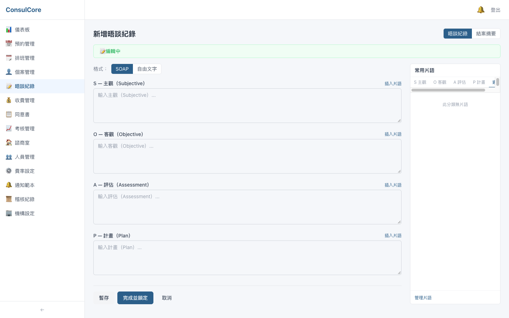

# 整合測試報告 — Frontend

> 測試日期：2026-10-12　｜　版本：`main` @ `f70b503`　｜　後端對應版本：`consulcore-backend` `main` @ `eca0dc3`
>
> 後端自動化測試、端對端情境與 API 相關問題見後端報告：`consulcore-backend/docs/test-report.md`

## 總覽

| 項目 | 結果 | 說明 |
|------|------|------|
| 型別檢查（`npm run type-check`） | ✅ 無錯誤 | TypeScript 6、vue-tsc |
| Lint（`npm run lint`） | ✅ 無警告 | |
| 單元 / 元件測試（`npm test`） | ✅ 174 / 174 通過 | 36 個測試檔 |
| 生產建置（`npm run build`） | ✅ 成功 | |
| 畫面操作測試 | ✅ 33 個畫面，無 console 錯誤、無失敗的 API 請求 | 擁有者、心理師、個案三種身分；桌機 1440 px 與手機 390 px |
| CI（GitHub Actions） | ✅ `main` 通過 | |

畫面操作測試發現 **17 項問題**（功能缺陷 6、顯示與文案 7、體驗建議 4），詳見[發現的問題](#發現的問題)，**尚未修正**。

## 測試方式

1. 後端以全新的暫存 SQLite 啟動，執行 `scripts/seed-demo.py` 建立示範診所「晴光心理諮商所」：擁有者、行政、2 位心理師、6 位個案（2 位有個案端帳號）、兩週排班、12 筆預約（含完成、取消）、SOAP 晤談紀錄、收費、套餐、常態預約、同意書、考核與違規紀錄
2. 前端以 `npm run dev` 啟動，用 Playwright 依序以三種身分登入，逐頁操作並截圖
3. 同時監聽瀏覽器 console 與網路請求：全程沒有 console 錯誤或警告，也沒有 4xx / 5xx 的 API 回應

## 畫面巡覽

### 機構後台（擁有者）

| 登入 | 儀表板 |
|---|---|
|  |  |

| 預約管理（週檢視） | 排班管理 |
|---|---|
|  |  |

| 個案管理 | 個案詳情 |
|---|---|
|  |  |

| 收費管理 | 營收報表 |
|---|---|
|  |  |

| 同意書管理 | 考核管理 |
|---|---|
|  |  |

| 診間設定 | 人員管理 |
|---|---|
|  |  |

| 費率設定 | 通知範本 |
|---|---|
|  |  |

| 稽核紀錄 | 機構設定（表單範本） |
|---|---|
|  |  |

### 心理師

| 儀表板 | 個案晤談紀錄（已鎖定） | 個案備忘錄 |
|---|---|---|
|  |  |  |

### 個案端

| 首頁 | 我的預約 | 預約諮商 |
|---|---|---|
|  |  |  |

| 同意書 | 通知 | 設定 |
|---|---|---|
|  |  |  |

### 手機（390 px）

| 個案首頁 | 個案預約 | 後台預約（日檢視） | 後台選單 | 個案詳情 |
|---|---|---|---|---|
|  |  |  |  |  |

## 發現的問題

嚴重度：**高** = 功能無法使用或給出錯誤資訊；**中** = 功能可用但有明顯錯誤；**低** = 顯示、文案或體驗改善。

### A. 功能缺陷

#### F1. 側欄「晤談紀錄」進入沒有指定個案的新增頁（高）

側欄連到 `/admin/sessions/new`，頁面沒有選擇個案的欄位，送出時個案 id 是 0，必然失敗。實際可用的入口是心理師在個案詳情「晤談紀錄」分頁按「新增紀錄」。另外，常用片語的分類列出現捲軸，最後一個分類被截斷。

- 建議：側欄改連到「晤談紀錄清單」（例如我的待完成紀錄），或在新增頁加入個案選擇；片語分類列套用 `scrollbar-none`

#### F2. 手機寬度沒有登出按鈕（高）

後台頂部的「登出」在寬度 < 640 px 時隱藏，手機選單裡也沒有，手機上無法登出（個案端正常）。

- 建議：在手機選單底部加入登出

#### F3. 「帳號已建立」通知寫著已廢止的初始密碼規則（高，後端 B1）

見後端報告 B1。

#### F4. 個案詳情「預約紀錄」的「查看」按了沒有反應（中）

`ClientDetailView.handleAppointmentClick` 是空函式（註解寫「可擴展為顯示詳情 modal」），按鈕可以點但什麼都不會發生。

- 建議：開啟預約詳情（預約管理頁已有 `AppointmentCard`），或先移除按鈕

#### F5. 通知範本「必要」欄顯示 `false`（中）

必要的範本顯示紅字「必要」，非必要的直接印出 `false`。

- 建議：非必要顯示「—」或留白

#### F6. 預約完成率趨勢與總覽不一致（中，後端 B2）

見後端報告 B2：同一位心理師總覽 100%、趨勢同月 33.3%。

### B. 顯示與文案

| # | 位置 | 問題 | 截圖 |
|---|---|---|---|
| F7 | 個案詳情 | 性別顯示原始值 `female` / `male` | [個案詳情](./screenshots/06a-client-detail.png) |
| F8 | 人員管理 | 角色顯示英文代碼 `owner`、`therapist`；有帳號的個案也列在人員清單 | [人員管理](./screenshots/12-staff.png) |
| F9 | 稽核紀錄、個案稽核分頁 | 動作顯示 `login`、`create`；資源 `client_memo` 未翻譯（後端 B3） | [稽核紀錄](./screenshots/15-audit-log.png) |
| F10 | 側欄 vs 頁面標題 | 側欄寫「諮商室」，頁面標題與其他頁面寫「診間」 | [診間設定](./screenshots/11-rooms.png) |
| F11 | 機構設定 | 頁名是「機構設定」，內容只有表單範本管理 | [機構設定](./screenshots/16-org-settings.png) |
| F12 | 收費管理篩選列 | 日期欄標籤字小、其他欄標籤字大；查詢 / 重置 / 匯出按鈕比輸入框矮 | [收費管理](./screenshots/08-billing.png) |
| F13 | 心理師儀表板 | 「今日預約」只計「已排定」，今天已完成的預約不算，今日排程顯示「今日尚無預約」 | [心理師儀表板](./screenshots/20-therapist-dashboard.png) |

### C. 體驗建議

| # | 位置 | 建議 | 截圖 |
|---|---|---|---|
| F14 | 擁有者儀表板 | 只有 4 張數字卡，畫面大片空白；可加入今日預約清單或近期營收圖 | [儀表板](./screenshots/02-dashboard.png) |
| F15 | 預約行事曆 | 灰色（已完成）、紅色（已取消）沒有圖例；排班頁有圖例可沿用 | [預約管理](./screenshots/03-appointments.png) |
| F16 | 個案「預約諮商」 | 提示「建議維持固定心理師」，但沒有標出個案目前的心理師 | [預約諮商](./screenshots/32-client-new-appointment.png) |
| F17 | 個案詳情 | 身分證字號完整顯示；可預設遮罩、點擊才顯示並留稽核 | [個案詳情](./screenshots/06a-client-detail.png) |
